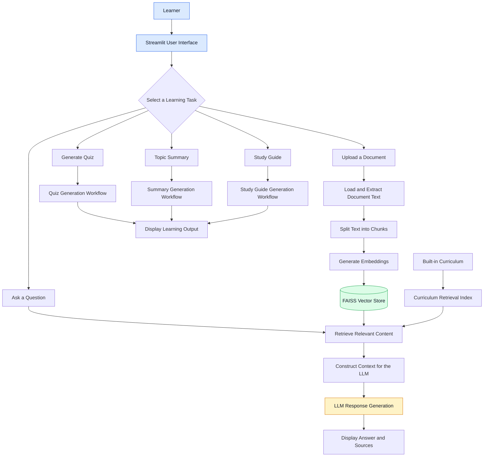

# EduSmart-Agentic-RAG 🎓
### An AI-Powered Learning Assistant Using RAG and Agentic AI

EduSmart-Agentic-RAG is an AI-powered educational assistant designed to help students understand study materials, get context-aware answers, practice with quizzes, generate topic summaries, and prepare study guides.

The application combines **Retrieval-Augmented Generation (RAG), vector search, Large Language Models (LLMs), and agent-oriented workflows** to make learning more interactive and document-focused.

Users can ask questions about the built-in curriculum or upload their own study documents and use the application to learn from their content.

## 🚀 Live Project Links

| Resource | Link |
|---|---|
| 🌐 Live Application | [Open EduSmart AI Assistant](https://edusmart-agentic-rag-woaxfsenr5nnztvnxcrkw8.streamlit.app/) |
| 💻 GitHub Repository | [View Source Code](https://github.com/S2023-maker/EduSmart-Agentic-RAG) |
| 🐳 Docker Hub | [View Docker Image](https://hub.docker.com/r/shreyarjoshi1995/edusmart-agentic-rag) |

## 🎯 Problem Statement

Students often need to read large study documents, search for specific concepts, prepare revision notes, and create practice questions. Finding relevant information manually can be time-consuming.

General-purpose AI assistants can also produce answers that are not sufficiently grounded in a learner's specific study materials.

EduSmart-Agentic-RAG addresses these challenges by retrieving relevant document content before generating answers and providing additional learning tools in one application.

## 💡 Key Features

- **Ask EduSmart:** Ask questions and receive answers based on relevant curriculum or uploaded document content.
- **Document Upload:** Upload supported study documents and query their content.
- **Retrieval-Augmented Generation:** Retrieve relevant text chunks before generating a response.
- **Agentic AI Workflow:** Organize educational tasks through an agent-oriented workflow.
- **Quiz Generation:** Generate multiple-choice questions for knowledge practice.
- **Topic Summary:** Produce concise summaries of study topics.
- **Study Guide:** Generate structured material to support revision.
- **Retrieval Evaluation:** Measure retrieval performance using Precision@K, Recall@K, and Mean Reciprocal Rank.
- **Answer-Quality Checks:** Test expected answer behavior.
- **Automated Testing:** Use Pytest to validate important application functionality.
- **Docker Support:** Package the application and its dependencies into a portable container.

## 🏗️ System Architecture

The following diagram explains how a learner interacts with EduSmart-Agentic-RAG and how the application processes a question.



*Note: The diagram is a conceptual view of the application's components and task paths. It does not imply that every task follows the same execution sequence.*

## 🔍 Understanding the RAG Pipeline

Retrieval-Augmented Generation helps an LLM answer questions using relevant information retrieved from a knowledge source.

### Step 1: Document Loading

The application uses built-in curriculum content and can process uploaded study documents.

Document text is extracted so that it can be searched and used as context.

### Step 2: Text Chunking

Long documents are divided into smaller, manageable text segments called *chunks*.

Chunking helps the retrieval system find relevant sections without needing to pass an entire document to the LLM for every question.

### Step 3: Embedding Generation

Each text chunk is represented as a numerical vector called an *embedding*. Embeddings capture semantic information about the text.

The project uses the Hugging Face Sentence Transformers model:

`sentence-transformers/all-MiniLM-L6-v2`

### Step 4: Vector Storage and Retrieval

The FAISS vector store supports similarity search over embedded content.

When a learner asks a question, the retrieval system searches for relevant chunks and returns the most useful candidates for the response.

### Step 5: Context-Aware Answer Generation

The retrieved content is provided to the LLM as context. The model uses that context to generate an answer relevant to the learner's question.

This approach can improve grounding in the available study materials, although it does not guarantee that every answer will be correct.

## 🤖 Where Agentic AI Fits In

Traditional RAG commonly follows a straightforward sequence: retrieve relevant content and generate an answer.

An agentic system can extend this approach by organizing tasks, selecting appropriate operations, and coordinating multiple steps.

In EduSmart-Agentic-RAG, the application supports several educational tasks, including question answering, quiz generation, summaries, and study guides.

**The distinction is important:** RAG is the retrieval-and-generation approach; agentic AI refers to the orchestration of tasks and decisions around that process. The exact agent behavior depends on the workflow implemented in the source code.

## 🧰 Technology Stack

| Technology | Purpose |
|---|---|
| Python | Core application logic |
| Streamlit | Interactive web interface |
| LangChain | LLM and retrieval integrations |
| LangGraph | Agent/workflow orchestration where implemented |
| FAISS | Vector similarity search |
| Hugging Face Sentence Transformers | Text embedding generation |
| Groq LLM integration | Language-model inference |
| PyPDF | PDF document processing |
| Pytest | Automated testing |
| Docker | Containerization and reproducible execution |
| Streamlit Community Cloud | Hosted application deployment |
| Docker Hub | Container image distribution |

## 📊 Evaluation and Testing

The project includes retrieval evaluation, answer-quality checks, and automated tests.

### Retrieval Metrics

| Metric | What it measures |
|---|---|
| Precision@K | How many of the top-K retrieved results are relevant |
| Recall@K | How much of the relevant content is retrieved in the top K |
| Mean Reciprocal Rank (MRR) | How highly the first relevant result is ranked |

### Previously Recorded Results

| Evaluation | Result |
|---|---:|
| Average Precision@4 | 0.75 |
| Chapter Recall@4 | 1.00 |
| Mean Reciprocal Rank (MRR) | 1.00 |
| Answer-quality checks | 5/5 |
| Automated tests | 6 passed |

These are results from the project's recorded evaluation run, not a guarantee of universal accuracy. The evaluation dataset, test cases, and retrieval configuration affect the results.

## 🐳 Run with Docker

Docker allows the application to run in a container without manually installing every Python dependency on the host machine.

### Prerequisites

- Docker Desktop or another Docker-compatible runtime
- A valid local `.env` file containing the API credentials required by the application
- Internet access for downloading the image and calling the configured LLM service

### 1. Pull the Published Image

```bash
docker pull shreyarjoshi1995/edusmart-agentic-rag:latest
```

### 2. Start the Container

Create a local `.env` file with the required environment variables. Never commit this file or share it publicly.

```bash
docker run -d \
  --name edusmart \
  -p 8501:8501 \
  --env-file .env \
  shreyarjoshi1995/edusmart-agentic-rag:latest
```

### 3. Open the Application

Visit:

http://localhost:8501

### 4. Useful Docker Commands

Check whether the container is running:

```bash
docker ps
```

View application logs:

```bash
docker logs edusmart
```

Stop the container:

```bash
docker stop edusmart
```

Start it again:

```bash
docker start edusmart
```

Remove the stopped container:

```bash
docker rm edusmart
```

## 💻 Run Locally from Source

### 1. Clone the Repository

```bash
git clone https://github.com/S2023-maker/EduSmart-Agentic-RAG.git
cd EduSmart-Agentic-RAG
```

### 2. Create and Activate a Virtual Environment

Windows PowerShell:

```powershell
py -3.11 -m venv .venv
.\.venv\Scripts\Activate.ps1
```

### 3. Install Dependencies

```powershell
python -m pip install --upgrade pip
pip install -r requirements.txt
```

### 4. Configure Environment Variables

Create a `.env` file in the project root and add the credentials required by your application.

Do not commit `.env` to GitHub.

### 5. Start the Application

```powershell
streamlit run frontend/streamlit_app.py
```

Open the local URL shown in the terminal.

## 📁 Project Structure

```text
EduSmart-Agentic-RAG/
│
├── app/                    # Core application modules
├── frontend/               # Streamlit interface
├── curriculum/              # Built-in learning content
├── evaluation/              # Evaluation scripts and reports
├── tests/                   # Automated tests
├── faiss_index/             # Curriculum retrieval index
├── vectorstore/             # Vector-store related files
├── ingest.py                # Document ingestion entry point
├── requirements.txt         # Python dependencies
├── Dockerfile               # Docker image configuration
├── docker-compose.yml       # Docker Compose configuration
├── .dockerignore             # Files excluded from Docker build context
├── .env.example              # Example environment configuration
└── README.md                 # Project documentation
```

*Generated indexes and local runtime files may vary depending on the environment and ingestion workflow.*

## 🔐 Security Considerations

- Keep API keys and credentials in environment variables.
- Never commit `.env`, access tokens, or private documents.
- Review Docker image contents before publishing the image publicly.
- Remember that `.dockerignore` excludes files from the build context but does not remove secrets already embedded in an existing image.
- Avoid uploading confidential documents to a hosted application unless you understand its data-handling behavior.

## 🔮 Potential Future Improvements

- Expand evaluation datasets and add regression tests for answer quality.
- Add more detailed source citations and retrieval transparency.
- Improve handling of questions that cannot be answered from available content.
- Add monitoring for latency, token usage, and retrieval failures.
- Expand support for document formats and educational workflows.
- Explore more advanced agent routing and evaluation strategies.

## 👩‍💻 Author

**Shreya Joshi**

Data Science | Generative AI | Retrieval-Augmented Generation | Agentic AI

Interested in building practical AI applications that combine machine learning, LLMs, retrieval systems, and deployment technologies.

---

⭐ If you find this project useful, consider exploring the repository and trying the live demo.
