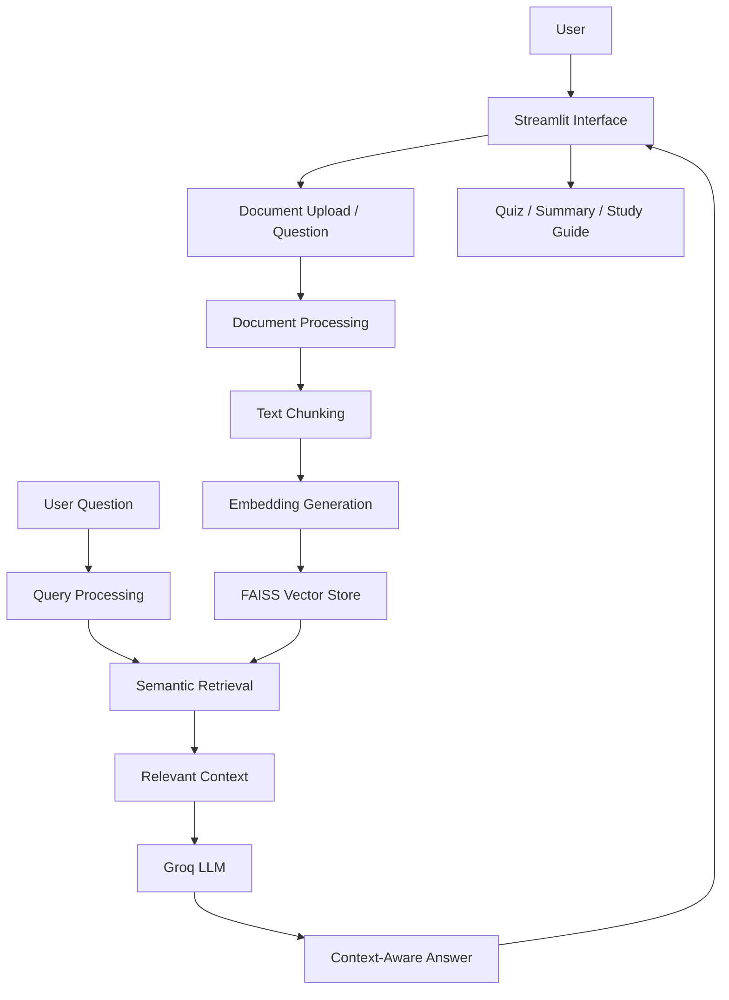

# 🎓 EduSmart-Agentic-RAG — AI-Powered Learning Assistant

An AI-powered learning assistant built using **Generative AI, Retrieval-Augmented Generation (RAG), LangChain, FAISS, and Streamlit**. EduSmart helps learners interact with educational documents, retrieve relevant information, generate quizzes, and create study materials through a conversational interface.

🔗 **Live Demo:** https://edusmart-agentic-rag-woaxfsenr5nnztvnxcrkw8.streamlit.app/

🔗 **GitHub Repository:** [EduSmart-Agentic-RAG](https://github.com/S2023-maker/EduSmart-Agentic-RAG)

## 🖥️ Application Screenshots

### EduSmart AI Tutor — Home Interface


### AI-Powered Question Answering


## 🚀 Key Features

- **AI-Powered Q&A:** Ask questions and receive context-aware answers using RAG.
- **Document Upload:** Process supported educational files, including PDF, DOCX, TXT, MD, CSV, XLSX, and PPTX.
- **Semantic Search:** Retrieve relevant document chunks using embeddings and FAISS.
- **AI Quiz Generation:** Generate multiple-choice quizzes with answer validation and explanations.
- **Topic Summaries:** Create concise summaries of educational topics.
- **Study Guide Generation:** Organize learning content into structured study material.
- **Built-in Curriculum:** Answer questions using the available curriculum when uploaded documents are not present.
- **RAG Evaluation:** Evaluate retrieval performance and expected answer behavior.
- **Automated Testing:** Validate application and retrieval functionality using pytest.
- **Containerization:** Package the application using Docker for reproducible deployment.

## 🛠️ Tech Stack

| Category | Technologies |
|---|---|
| Programming | Python |
| Frontend | Streamlit |
| LLM Integration | Groq API |
| Generative AI | Large Language Models (LLMs) |
| RAG Framework | LangChain |
| Embeddings | Sentence Transformers — `all-MiniLM-L6-v2` |
| Vector Database | FAISS |
| Document Processing | LangChain document loaders and text splitters |
| Data Validation | Pydantic |
| Evaluation | Retrieval metrics, custom evaluation scripts |
| Testing | pytest |
| Deployment | Streamlit Community Cloud, Render |
| Containerization | Docker |

## 🏗️ System Architecture



### How RAG Works

1. **Document ingestion:** Load supported documents and extract their text.
2. **Text chunking:** Split the extracted text into smaller, manageable chunks.
3. **Embedding generation:** Convert text chunks into numerical vector representations.
4. **Vector storage:** Store the embeddings in a FAISS index.
5. **Semantic retrieval:** Retrieve relevant chunks for the user's question.
6. **Answer generation:** Pass the retrieved context to the LLM to generate a relevant response.
7. **Evaluation:** Measure retrieval quality and run expected-behavior checks.

## 📂 Project Structure

```text
EduSmart-Agentic-RAG/
│
├── app/
│   ├── llm.py
│   ├── retriever.py
│   ├── rag.py
│   ├── quiz.py
│   └── tools.py
│
├── frontend/
│   └── streamlit_app.py
│
├── curriculum/
├── faiss_index/
├── vectorstore/
├── evaluation/
├── tests/
│
├── ingest.py
├── rag_evaluation.py
├── retrieval_evaluation.py
├── compare_top_k.py
│
├── requirements.txt
├── Dockerfile
├── docker-compose.yml
├── .env.example
├── .gitignore
└── README.md
```

*Note: This structure highlights the main project components. Some evaluation scripts or directories may be located elsewhere in your current repository.*

## ⚙️ Installation and Local Setup

### 1. Clone the repository

```bash
git clone https://github.com/S2023-maker/EduSmart-Agentic-RAG.git
cd EduSmart-Agentic-RAG
```

### 2. Create a virtual environment

**Windows PowerShell**

```powershell
py -3.11 -m venv .venv
.\.venv\Scripts\Activate.ps1
```

### 3. Install dependencies

```bash
python -m pip install --upgrade pip
pip install -r requirements.txt
```

### 4. Configure environment variables

Create a `.env` file in the project root using `.env.example` as a reference.

```env
GROQ_API_KEY=your_groq_api_key
```

Use the actual variable names required by your code. If your application uses additional services, configure their credentials separately. **Never commit API keys, passwords, or service-role keys to GitHub.**

### 5. Run the application

```bash
streamlit run frontend/streamlit_app.py
```

Open the local URL displayed in the terminal, usually `http://localhost:8501`.

## 🐳 Run with Docker

Build the Docker image:

```bash
docker build -t edusmart-agentic-rag .
```

Run the container:

```bash
docker run --env-file .env -p 8501:8501 edusmart-agentic-rag
```

Open `http://localhost:8501` in your browser.

For Render or another container host, configure the application to bind to `0.0.0.0` and use the port supplied by the hosting platform.

## 📊 Evaluation and Testing

The project includes retrieval evaluation, answer-behavior checks, and automated tests.

### Retrieval Evaluation

| Metric | Recorded Result |
|---|---:|
| Average Precision@4 | 0.75 |
| Chapter Recall@4 | 1.00 |
| Mean Reciprocal Rank (MRR) | 1.00 |

These are results from the project's recorded evaluation run, not a guarantee of performance on every dataset.

### Answer-Quality Checks

- **5/5 expected-behavior checks passed** in the recorded evaluation.
- Retrieval relevance and expected answer behavior are evaluated separately.

### Run the tests

```bash
python -m pytest -v
```

Run the evaluation scripts available in the repository:

```bash
python retrieval_evaluation.py
python rag_evaluation.py
```

Check the exact script paths in your repository if these commands differ from your current setup.

## ☁️ Deployment

The project has been deployed using Streamlit Community Cloud and Docker-based hosting.

- **Streamlit Community Cloud:** Provides a public interface for demonstrating the application.
- **Render:** Used to explore container-based deployment.
- **Docker:** Supports consistent packaging and local execution.

Cloud deployment is subject to platform-specific memory, compute, and usage limits. Large embedding models and vector indexes can increase resource consumption.

## 🔐 Security Considerations

- Store API keys in environment variables or your hosting platform's secret manager.
- Never expose private service credentials in source code.
- Configure appropriate access controls for uploaded documents and stored conversation data.
- Avoid logging sensitive document content or user credentials.

## 🔮 Future Enhancements

- Integrate **Qdrant Cloud** for managed vector storage.
- Add a FastAPI backend with dedicated REST endpoints.
- Implement persistent conversation history using Supabase.
- Add response faithfulness and context-relevance evaluation.
- Introduce CI/CD with GitHub Actions.
- Improve caching and memory efficiency for resource-constrained deployments.
- Add authentication, monitoring, and structured application logging.

*These are planned enhancements, not claims about currently implemented features.*

## 💡 Key Learning Outcomes

This project demonstrates practical experience with:

- Building a Retrieval-Augmented Generation pipeline.
- Integrating LLM APIs into an application.
- Implementing semantic search using embeddings and FAISS.
- Processing multiple document formats.
- Generating structured outputs with validation.
- Evaluating retrieval performance and testing expected behavior.
- Containerizing and deploying a Python AI application.

## 👩‍💻 Author

**Shreya Joshi**

AI/ML and Data Science portfolio project focused on Generative AI, RAG, semantic retrieval, evaluation, and application deployment.

---

⭐ If you find this project useful, consider starring the repository.
