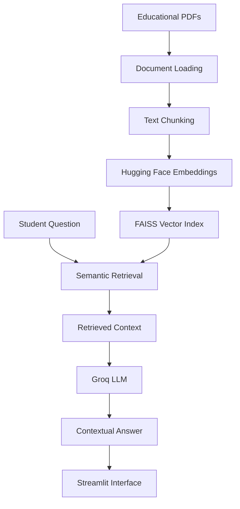

# EduSmart-Agentic-RAG
### An AI-Powered Educational Assistant Using Retrieval-Augmented Generation

EduSmart-Agentic-RAG is an AI-powered learning assistant designed to help students understand educational content through document-based question answering, topic summaries, quiz generation, and study guides.

The application combines Retrieval-Augmented Generation (RAG), semantic search, vector databases, and Large Language Models (LLMs) to generate contextual answers grounded in retrieved educational material.

## Table of Contents

- [Project Overview](#project-overview)
- [Objectives](#objectives)
- [Key Features](#key-features)
- [System Architecture](#system-architecture)
- [RAG Workflow](#rag-workflow)
- [Technology Stack](#technology-stack)
- [Project Structure](#project-structure)
- [Installation and Setup](#installation-and-setup)
- [Running the Application](#running-the-application)
- [Evaluation and Testing](#evaluation-and-testing)
- [Current Results](#current-results)
- [Limitations](#limitations)
- [Security](#security)
- [Future Improvements](#future-improvements)

## Project Overview

Students often need to search lengthy educational documents to find relevant explanations, revise topics, and prepare for examinations.

EduSmart-Agentic-RAG provides an interactive interface where users can ask questions about educational material and receive answers based on retrieved document content.

The project demonstrates an end-to-end GenAI application that combines document processing, vector-based retrieval, LLM integration, interactive learning tools, and evaluation.

## Objectives

- Build a practical application using Generative AI and RAG.
- Retrieve relevant information from educational documents.
- Generate contextual answers using an LLM.
- Provide learning support through quizzes, summaries, and study guides.
- Reduce unsupported responses by grounding answers in retrieved context.
- Evaluate retrieval performance and expected answer behavior.
- Develop a reproducible application suitable for further deployment.

## Key Features

### 1. Document-Based Question Answering
Ask natural-language questions about educational material and receive student-friendly explanations using retrieved context.

### 2. Retrieval-Augmented Generation
Combines semantic document retrieval with LLM-based response generation to provide context-aware answers.

### 3. PDF Document Processing
Processes educational PDFs, splits extracted text into smaller chunks, and prepares the content for semantic search.

### 4. Vector Search with FAISS
Uses FAISS to store and retrieve vector embeddings efficiently.

### 5. Hugging Face Embeddings
Uses the `sentence-transformers/all-MiniLM-L6-v2` embedding model to represent text as vectors for semantic retrieval.

### 6. Groq LLM Integration
Uses Groq through LangChain to generate natural-language answers from the retrieved context.

### 7. Interactive Learning Tools
The Streamlit interface provides:
- Ask EduSmart
- Take a Quiz
- Topic Summary
- Study Guide

### 8. Source-Aware Responses
Retrieved document metadata can be used to identify supporting sources and page information.

### 9. Evaluation and Testing
Includes automated tests, retrieval evaluation, response-behavior checks, and latency measurement scripts.

## System Architecture



## RAG Workflow

**Step 1 — Document ingestion**

Educational PDFs are loaded and their text is extracted.

**Step 2 — Text chunking**

Documents are divided into smaller, overlapping chunks to improve retrieval.

**Step 3 — Embedding generation**

The embedding model converts document chunks into numerical vectors.

**Step 4 — Vector indexing**

FAISS stores the vectors and associated document information for similarity-based retrieval.

**Step 5 — Question processing**

The student's question is embedded and used to retrieve relevant passages from the vector store.

**Step 6 — Context construction**

Retrieved passages are formatted and passed to the language model as context.

**Step 7 — Answer generation**

The Groq-hosted LLM generates a response using the supplied context and the application's grounding instructions.

**Step 8 — User interaction**

The Streamlit application displays the response and available source information.

## Technology Stack

| Component | Technology |
|---|---|
| Programming language | Python |
| User interface | Streamlit |
| LLM provider | Groq |
| LLM integration | LangChain |
| Embedding model | Sentence Transformers |
| Vector database | FAISS |
| Document processing | PyPDFLoader and text splitters |
| Automated testing | Pytest |
| Evaluation | Python and CSV reports |
| Containerization | Docker and Docker Compose |

## Project Structure

```text
EduSmart-Agentic-RAG/
│
├── app/
│   ├── llm.py
│   ├── rag.py
│   ├── retriever.py
│   ├── prompts.py
│   └── ...
│
├── curriculum/
│   └── Educational PDF files
│
├── evaluation/
│   ├── eval_dataset.json
│   ├── rag_evaluation.py
│   ├── retrieval_evaluation.py
│   ├── answer_quality_evaluation.py
│   └── ...
│
├── faiss_index/
│   ├── index.faiss
│   └── index.pkl
│
├── frontend/
│   └── streamlit_app.py
│
├── tests/
│   ├── test_llm.py
│   ├── test_rag.py
│   └── test_retriever.py
│
├── .env.example
├── .gitignore
├── Dockerfile
├── docker-compose.yml
├── ingest.py
├── requirements.txt
├── test_latency.py
└── README.md
```

*Some application modules and files are omitted from this overview for readability.*

## Installation and Setup

### Prerequisites

- Python 3.11 recommended for this project
- Git
- A Groq API key
- Internet access for downloading model files and accessing the LLM API

### 1. Clone the repository

```bash
git clone https://github.com/S2023-maker/EduSmart-Agentic-RAG.git
cd EduSmart-Agentic-RAG
```

### 2. Create a virtual environment

```powershell
python -m venv .venv
```

Activate it on Windows:

```powershell
.\.venv\Scripts\Activate.ps1
```

### 3. Install dependencies

```bash
python -m pip install -r requirements.txt
```

### 4. Configure environment variables

Create a local `.env` file in the project root and add your own Groq API key:

```text
GROQ_API_KEY=your_groq_api_key_here
```

Replace the placeholder with your actual key. Never commit the real `.env` file to GitHub.

### 5. Prepare the vector index

If the prebuilt index is unavailable or you need to regenerate it, place the required curriculum PDFs in the expected directory and run:

```bash
python ingest.py
```

This prepares the FAISS index used by the retrieval pipeline.

## Running the Application

Start the Streamlit application from the project root:

```bash
streamlit run frontend/streamlit_app.py
```

Open the local URL printed in the terminal, usually:

`http://localhost:8501`

You can then ask questions, explore the learning tools, and test the application's responses.

## Evaluation and Testing

The project includes scripts for evaluating retrieval behavior, answer generation, and basic functionality.

### Run automated tests

```bash
python -m pytest -v
```

### Run retrieval evaluation

```bash
python evaluation/retrieval_evaluation.py
```

The retrieval evaluation reports:

- Precision@K
- Chapter Recall@K
- Mean Reciprocal Rank (MRR)

These metrics help assess whether the expected chapter appears among the retrieved results and how highly it is ranked.

### Run answer-quality evaluation

```bash
python evaluation/answer_quality_evaluation.py
```

This script checks response generation, empty answers, and expected behavior for supported and unsupported questions.

### Run RAG evaluation

```bash
python evaluation/rag_evaluation.py
```

### Latency testing

The project also includes `test_latency.py` for measuring response time. Actual latency depends on model response time, hardware, network conditions, and retrieval overhead.

## Current Results

The following results were observed during the current development-stage evaluation.

| Evaluation | Result |
|---|---|
| Automated tests | 6 passed |
| Number of retrieval evaluation questions | 5 |
| Average Precision@4 | 0.75 |
| Chapter Recall@4 | 1.00 |
| Mean Reciprocal Rank | 1.00 |
| Answer expected-behavior checks | 5/5 passed |

### Interpreting the results

- **Precision@4 = 0.75:** On average, three of the four retrieved chunks belonged to the expected chapter, based on the current chapter-level relevance labels.
- **Chapter Recall@4 = 1.00:** At least one chunk from the expected chapter was retrieved for each of the five evaluation questions.
- **MRR = 1.00:** A relevant chapter appeared at rank 1 for each evaluated question.
- **Answer checks = 5/5:** All five responses passed the evaluation script's expected-behavior checks, including two questions whose answers were absent from the supplied documents.

These are preliminary results from a small test set. Chapter-level relevance does not guarantee that every retrieved passage is relevant, and heuristic answer checks do not establish factual accuracy. Larger test sets and manual faithfulness review are needed.

## Limitations

- Evaluation currently uses a small set of questions.
- Retrieval metrics are based on expected chapter labels rather than comprehensive passage-level annotations.
- Generated answers can still contain errors or unsupported details.
- Response latency can vary across requests.
- PDF processing depends on the quality and extractability of document text.
- Uploaded-document persistence and user-specific conversation storage depend on the application's configured storage behavior.
- Production use requires additional security, privacy, and deployment validation.

## Security

- Store API keys in environment variables, not in source code.
- Keep `.env`, local conversation history, uploaded private documents, and virtual environments out of version control.
- Use `.env.example` as a template containing placeholders only.
- Review uploaded files and document-handling behavior before accepting sensitive information.
- Restrict access appropriately before deploying for real users.

## Future Improvements

- Expand the evaluation dataset and add manually verified passage-level relevance labels.
- Improve retrieval with reranking and retrieval-quality comparisons.
- Add broader faithfulness and hallucination checks.
- Support additional document formats through appropriate loaders.
- Add persistent, user-specific conversation history and authentication where required.
- Improve latency through caching and model/retrieval optimization.
- Deploy the application with appropriate secrets management, monitoring, and access controls.
- Add a demonstration video and application screenshots.

## Project Status

The core application, initial retrieval and answer-quality evaluations, and automated tests have been completed. GitHub publishing and deployment validation are the next steps.

## Author

**Shreya Joshi**

GitHub: [S2023-maker](https://github.com/S2023-maker)
